<div align="center">
  
  <h1>Kiosque</h1>
  <p><strong>A Flatpak storefront for KDE Plasma</strong></p>
  <p>Browse Flathub like an app store, see what each app can do, and manage your Flatpak library in a native Plasma interface.</p>
  <p>
    <a href="#try-kiosque">Try Kiosque</a> ·
    <a href="#technical-architecture--data-flow">Architecture</a> ·
    <a href="#build-from-source">Build from source</a> ·
    <a href="#development-guidance-and-testing">Development</a>
  </p>
</div>

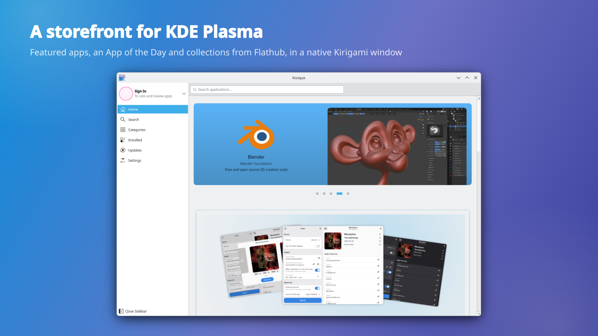

*Screenshots show Kiosque on KDE Plasma (KWin, Breeze) with live Flathub data.*

## Why Kiosque exists

Kiosque started when a GNOME user moved to KDE Plasma and missed the way Bazaar and GNOME Software made browsing for an app feel worthwhile. If all you have in mind is “I need something to edit audio,” a search box is only part of the answer. Kiosque gives you collections to explore, enough space to see what an app looks like, and a direct path from the first impression to the permissions it requests and the install action.

Discover covers the wider Plasma software workflow. Depending on the distribution and enabled backends, it can manage native packages and system updates alongside Flatpaks, and it can find Plasma add-ons. Kiosque concentrates its storefront and library on Flatpak. That focus gives the home page room for a dedicated daily spotlight, games by release and popularity, and a collection for apps suited to phones and tablets. Keep Discover for system software and Plasma add-ons, and open Kiosque when you want to explore Flathub or tend to your Flatpak library. [KDE Discover](https://invent.kde.org/plasma/discover)

### Design inspiration and credit

**Bazaar was the direct inspiration for Kiosque.** Kiosque began as a way to bring Bazaar’s approach to discovering Flatpaks to KDE Plasma. Its influence is clearest on the first screen. An editorial selection gives you a place to start, artwork shows what an unfamiliar app actually looks like, and the installed library is one step away. Kiosque implements those ideas in Qt Quick and Kirigami. Credit for the storefront concept and its curation model belongs to the Bazaar project and its contributors. [Bazaar upstream](https://gitlab.gnome.org/World/bazaar)

That influence also shaped what distributors can ship. Kiosque reads a subset of Bazaar’s YAML schema, including curated sections, featured carousels and app blocklists. A Plasma spin can use the same lists of app IDs to build its own front page. [Distributor configuration](rust/core/src/config.rs)

## Try Kiosque

Check [GitHub Releases](https://github.com/niltonperimneto/kiosque/releases) for downloads. Choose a package for your system when one is available.

- **Fedora RPM** — Download both RPMs, `kiosque` (the storefront) and `kiosque-companion` (background updates, KRunner and the host service), and install them together with `sudo dnf install ./kiosque-*.rpm`. Then open **Kiosque** from your application launcher.
- **AppImage** — Make the downloaded `.AppImage` executable and open it.
- **Flatpak** — The sandboxed app installs, removes and updates software through a native host companion. Install the `kiosque-companion` package on the host as well. It adds no second launcher. If it is missing or too old, Kiosque says which, instead of failing silently.

If there’s no suitable download, [build and run Kiosque from source](#build-from-source). For installing apps, see [Flathub’s setup guide](https://flathub.org/setup) to configure Flatpak and add the Flathub remote on your distribution.

Once it’s open, try **Games → New Releases**, then open a title and look at **Sandbox Permissions**. The **Installed** page shows the Flatpaks already on your machine and lets you focus on those with updates.

## From browsing to installing

- **Start with the storefront.** The featured carousel pairs app screenshots with colors from AppStream branding when available. Flathub’s App of the Day gets its own spotlight card, which lifts and glows under the pointer. Categories, game charts, and recently added or updated apps give you a way in even when you have no app name to search for. Search, categories and app details come from the AppStream data of every repository you have configured, so they also work offline and include apps from repositories other than Flathub.
- **Decide with the facts in front of you.** Screenshots, release notes, descriptions, ratings, and reviews help you judge the app itself. A chip shows which repository the app comes from, and Install uses that repository. The Sandbox Permissions panel lists the access the app requests, read from that repository’s own metadata. If the permissions cannot be verified, Kiosque does not offer to install the app. Before you install, the page names the runtime the app runs on and how much the installation downloads, including any runtime that is not installed yet. A runtime that no longer receives updates is flagged.
- **Come back to a usable library.** Search and sort installed Flatpaks and filter to pending updates. Installs, removals and updates run in the background and are listed in a Tasks dialog, where you can cancel them; each runtime an install pulls in is shown as its own step. Removing an app offers to remove the runtimes it leaves unused, and the Installed page lists every runtime with the apps that use it, so unused ones can be cleaned up. For ongoing maintenance, the companion installs updates on a daily or weekly schedule, and catches up after the computer was off.

| | |
| --- | --- |
| 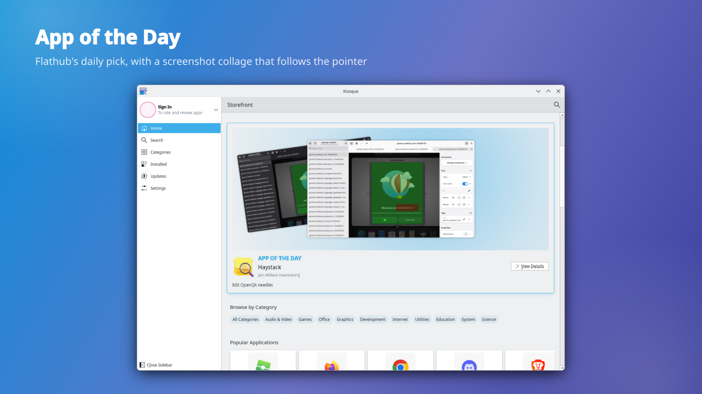 | 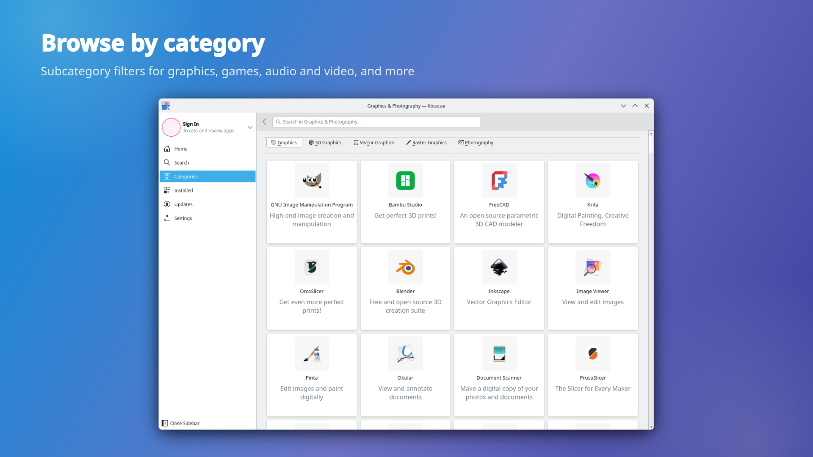 |
| 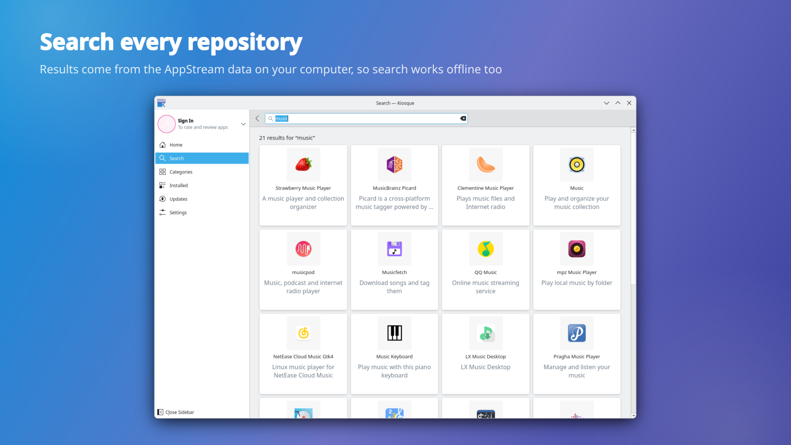 | 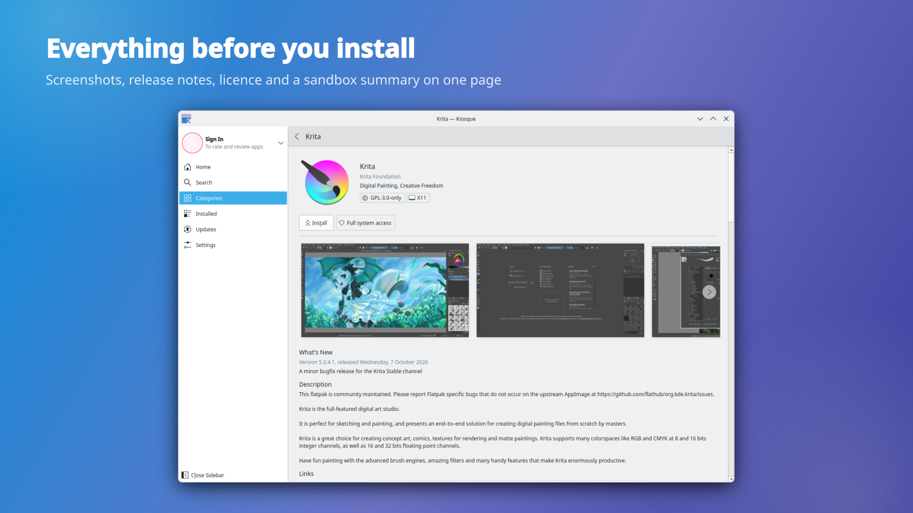 |
| 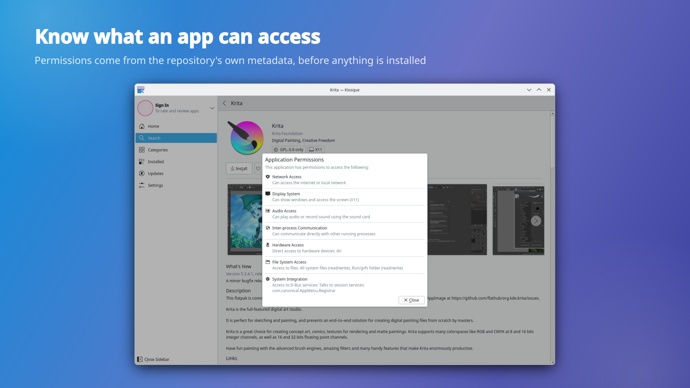 | 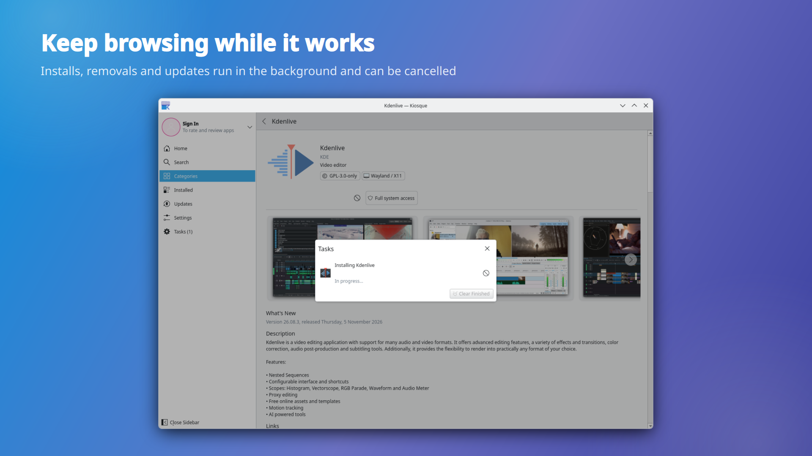 |
| 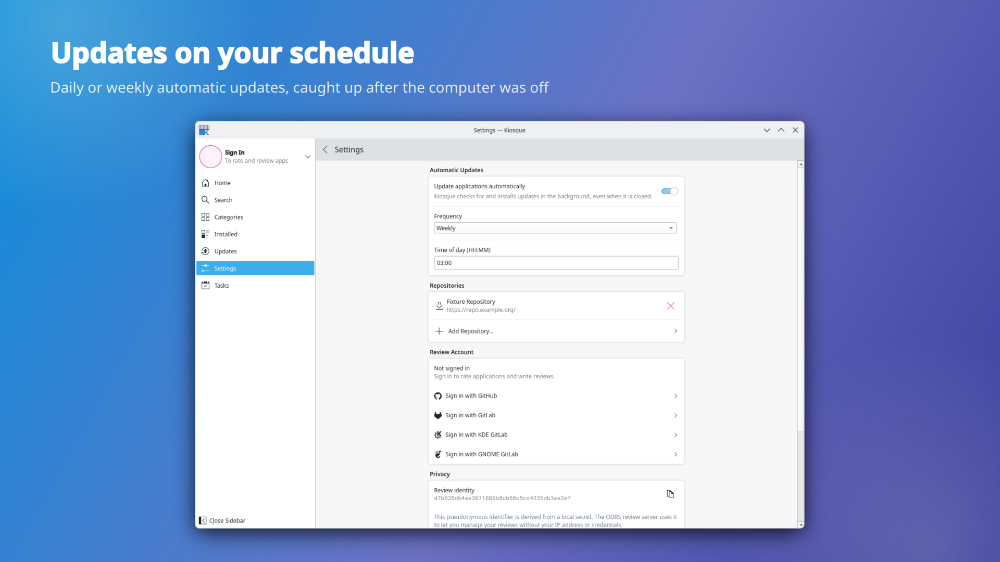 | 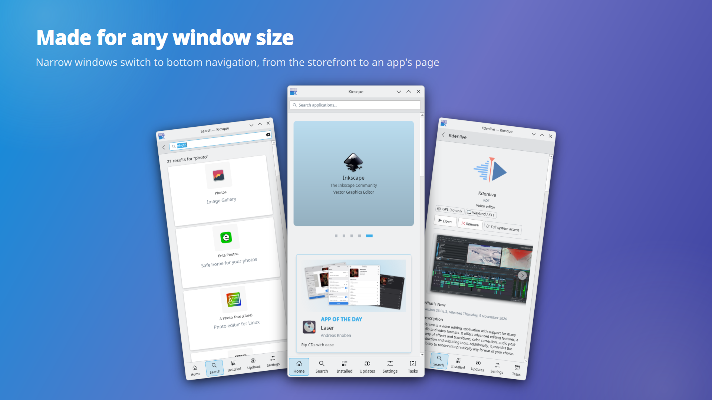 |

### Beyond the storefront

| When you want to… | Where to go |
| --- | --- |
| Find an app without opening the store first | With `kiosque-companion` installed, open Plasma’s runner and type at least three characters. Kiosque searches AppStream metadata already on disk for apps you can install. Selecting a match opens its detail page. |
| Inspect a Flatpak link or file someone shared | Open an `appstream://` link in Kiosque to go straight to an app. Open a `.flatpakref` or `.flatpakrepo` file to review its source, key fingerprint and installation scope before confirming. |
| Set up background updates | In **Settings → Updates**, choose a daily or weekly schedule and time. Enabling automatic updates requests desktop background permission, and the change applies immediately. The companion then installs updates with the storefront closed. A run missed while the computer was off happens shortly after the next login, and a failed run is retried an hour later. In the Flatpak version, Settings says whether the companion is installed and up to date, recognises a system that already updates Flatpaks on its own, and Kiosque keeps itself current through Flatpak either way. |
| Follow installs while browsing | Installs, removals and updates never block the window. **Tasks** in the sidebar lists queued, running and finished work, lets you cancel it and opens each app’s page. |
| Manage repositories or reviews | **Settings → Repositories** lists remotes and lets you add a repository. **Review Account** handles sign-in for ratings and reviews. **Privacy** shows the pseudonymous review identity and explains what regenerating its salt means for access to earlier reviews. |

## Build from source

### Requirements & Setup

To build and run Kiosque from source, ensure you have the following dependencies:

- **Compiler**: GCC/Clang with C++17 support, and the current stable Rust toolchain (`cargo` and `rustc`, with Rust 2024 edition support)
- **Build System**: Meson (version 1.4+), Ninja, and a supported linker such as mold
- **System Libraries**:
  - Qt6 (Core, Gui, Qml, Quick, QuickControls2, DBus, Widgets, SVG), including Qt's private development headers, which qtbridge needs
  - KF6 Kirigami (KDE Frameworks 6 UI component system)
  - KF6 KI18n 6.21 or newer, including I18nQml and the `org.kde.ki18n` QML module
  - Qt SVG image plugin, Kirigami Addons, and KDE desktop QML style at runtime
  - `dbus-1` (D-Bus message bus system library)
  - libflatpak development libraries for the default native backend (`-Dflatpak_backend=broker` selects the sandbox build)

The [desktop test prerequisites](docs/testing.md#suite-matrix) list package names for Fedora.

### Building & Installation

Kiosque uses Meson to build the project. Meson drives Cargo, which builds the `kiosque` storefront and the `kiosque-update` companion as Rust binaries; Meson then installs them with the QML resources, translations and desktop integration. The application has no C++ sources of its own.

```bash
# Clone the repository
git clone https://github.com/niltonperimneto/kiosque.git
cd kiosque

# Configure the build directory
meson setup build

# Compile all targets (executable and update daemon)
meson compile -C build
```

Once built, you can launch Kiosque or the background update utility.

```bash
# Launch the graphical storefront
./build/kiosque

# Launch the background update utility
./build/kiosque-update
```

Distribution packages split the build in two. `kiosque` is the storefront. `kiosque-companion` contains `kiosque-update`, its D-Bus activation file, the KRunner plugin, the tray icon and the translations. The storefront requires the companion, and Flatpak users install the companion on its own.

## Technical Architecture & Data Flow

Kiosque splits the desktop UI, application services, and Flatpak execution into layers. QML handles presentation and navigation, Rust owns catalog and transaction state, and libflatpak performs changes to the installation. The AppStream data of every configured repository is the base for search, categories and details; Flathub’s web API adds popularity, branding and reviews. The same application models serve the native and sandboxed packages through different backend implementations.

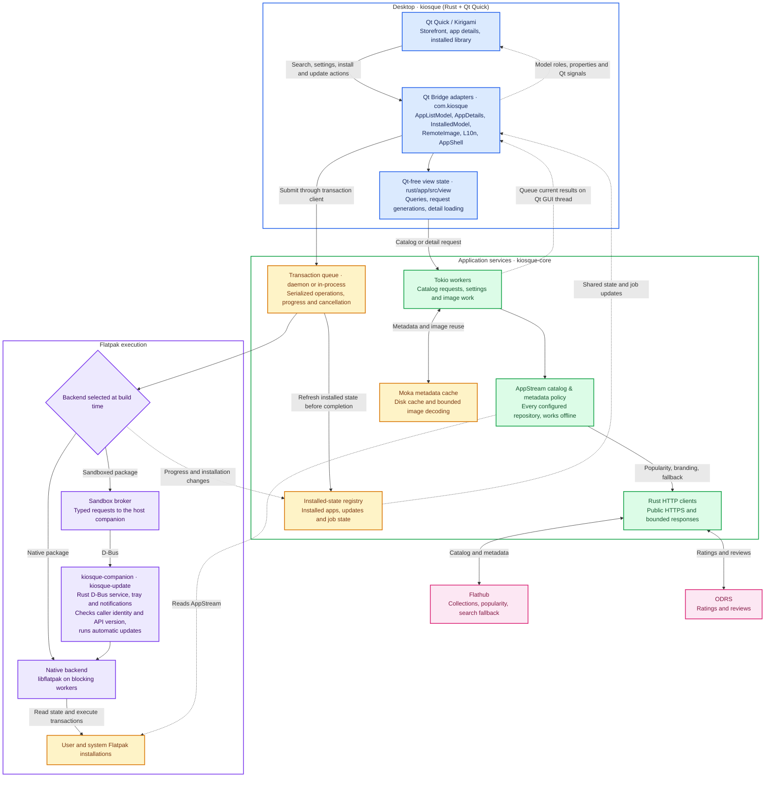

**Colors:** blue = desktop UI; green = application services; amber = state and storage; violet = Flatpak execution; pink = external APIs. Labels and group boundaries identify the same layers.

Solid arrows show requests, reads, and operations. Dashed arrows show results and state flowing back to the interface.

### Desktop views, Qt Bridge adapters and the view layer

- **Views.** `ShopfrontPage.qml` binds app collections to cards and search results. `AppDetailPage.qml` gets its own `AppDetails` object for metadata, permissions, and operation feedback. The installed library uses `InstalledModel`, and its runtimes `RuntimesModel`. `RuntimePlanner` asks the backend what an install or removal would do before you confirm it. Controllers expose shared operations and settings to QML.
- **Bindings.** The storefront is a Rust binary. Its QML types come from [Qt Bridge](https://crates.io/crates/qtbridge) (`qtbridge`, pinned to 0.4.1): each adapter in `rust/app/src/bridge/` is a `#[qobject]` module whose `qproperty!`, `#[qslot]` and `#[qsignal]` declarations become Qt properties, invokable methods and signals, registered as `com.kiosque` types at start-up. Qt Bridge still generates C++ glue internally, kept inside Cargo's target directory. [App manifest](rust/app/Cargo.toml) · [Adapters](rust/app/src/bridge/mod.rs)
- **View layer.** The adapters only translate. What to load, request generations, debouncing and detail assembly live in plain Rust under `rust/app/src/view/`, tested with `cargo test` and no Qt. [View state](rust/app/src/view/mod.rs)
- **Models and threads.** `AppListModel` and the other lists use Qt Bridge's list-model base, and QML delegates read the `name`, `summary`, `iconUrl`, and `appId` roles. Tokio does network and filesystem work in the background. Results return through `QThreadHandle::invoke_mut`, which is silently dropped if the QML object was destroyed meanwhile. Adapters emit signals only after their state is updated. QML handlers that call back into the emitting object defer with `Qt.callLater`, because a nested mutable borrow during an emission would abort.
- **Translations, images and start-up.** QML strings go through the `L10n` singleton (`L10n.i18n("%1 of %2", [a, b])`), backed by gettext catalogs. Images go through `RemoteImage`, described below. The `AppShell` singleton reports successful QML start-up for `kiosque --check-ui`. [L10n](rust/app/src/bridge/l10n.rs) · [AppShell](rust/app/src/bridge/app_shell.rs)

Kirigami’s page stack gives the storefront, search results and app details a common navigation history. Opening another app replaces the existing detail page, so following a series of recommendations does not leave a stack of detail views behind. The storefront cards share typography, hover timing and shadow defaults through a QML style singleton. The cards inherit the desktop font and use Qt’s vector text rendering to keep labels sharp as a card scales on hover. App-specific screenshots and branding provide the variation across the shelf. [Page navigation](qml/Main.qml) · [Storefront styling](qml/style/Style.qml)

### Application services, catalog, and caches

`kiosque-core` owns the catalog, service clients, caches, settings, installed-state registry, transaction queue, and Flatpak backend interface. The core builds with Rust alone under its default features. The native application enables the libflatpak feature. The desktop adapter wires up production services and supports isolated fixture endpoints and a mock backend in dedicated test builds. [Architecture guide](docs/architecture.md) · [Testing guide](docs/testing.md)

Flathub supplies collections, search, and AppStream metadata. The Open Desktop Ratings Service (ODRS) supplies ratings and reviews. The shared async HTTP client reuses connections, with up to four idle connections per host and a 15-second request timeout. Concurrent Moka caches keep collections for five minutes and app details, ratings, and reviews for ten. Featured content can appear from disk while a refresh runs. Review submissions invalidate that app’s cached ratings and reviews. The image loader coalesces duplicate downloads, keeps original bytes on disk, and limits decoded images in memory. [Flathub client](rust/core/src/flathub/client.rs) · [Cache policy](rust/core/src/cache.rs)

#### How a detail page gets its contents

Opening an app creates a page-scoped `AppDetails`. When the local catalog has the app, its repository’s AppStream data supplies the name, description, screenshots, links, release notes and origin, and the catalog supplies other apps by the same developer and similar apps, with no network request. The permissions come from the metadata keyfile that repository publishes for the app, converted to the same shape as Flathub’s summary. If that keyfile cannot be read, a Flathub app falls back to Flathub’s permission summary. An app from another repository then stays “unknown”, which disables Install. Apps not in the catalog yet use the Flathub web API. Ratings and review text come from a separate pair of ODRS requests, so a reviews outage leaves a page without ratings but still installable. A page reloads by itself when its app’s catalog entry changes. [App metadata policy](rust/core/src/apps.rs) · [Detail page](qml/pages/AppDetailPage.qml)

Artwork has a different lifetime from metadata. Scrolling past a card and opening the same image at a larger size can reuse the downloaded bytes. QML asks a `RemoteImage` object for an image by URL and purpose (an icon size, a screenshot or an avatar). The Rust image loader downloads it once, decodes and resizes it on blocking workers, and writes a sanitized PNG that QML loads as a local file, so remote image formats never reach Qt’s decoders directly. [Image loader](rust/core/src/image_cache.rs) · [RemoteImage](rust/app/src/bridge/remote_image.rs)

#### What comes from the network and what is already on disk

Flatpak keeps an AppStream catalog per remote, architecture and installation. Kiosque indexes those files with their origin and scope, refreshes them daily, and reindexes when you add or remove a repository. Search, categories and detail pages read that index first, so they work offline and cover every repository. While Flathub’s own data is not on disk yet, Flathub’s web search fills the gap. Distributor blocklists apply to search, categories, related apps and the storefront rows. Plasma’s KRunner integration searches the same index, filters out installed apps and returns up to eight matches. Choosing a match opens the app in the storefront: the native app when it is installed next to the companion, otherwise the Kiosque Flatpak. [Local catalog](rust/core/src/catalog.rs) · [KRunner integration](rust/core/src/daemon/runner.rs)

### Installed state, transactions, and the update helper

Consider installing a title from its detail page and then switching to **Installed** while the download runs. The page can disappear without losing the operation because the job belongs to the transaction manager. The two views observe the same installed-state registry.

1. **Choose the target.** For an already installed app, the resolver preserves its remote and user or system scope. For a new app it considers the requested remote and the local catalog, with Flathub as the default remote. The operation carries that target alongside the app ID.
2. **Assign one job.** On first use, the GUI transaction client tries the host daemon over the session bus. If unavailable, it uses an in-process queue. The manager gives identical pending operations the same job ID and runs jobs serially. Requests for different remotes or scopes remain distinct.
3. **Execute the operation.** Queue location and permission to change an installation are separate decisions. A native backend runs libflatpak on blocking workers. A sandbox build can only reach host Flatpak through the authenticated companion, even if the GUI has created a local queue. An unavailable companion produces a visible operation failure.
4. **Publish progress and reconcile state.** Views observe job progress through the registry using the job ID. Cancellation reaches active native work through GLib’s cancellable. After execution the manager attempts to reload installed refs before publishing the terminal job state. Installation monitors also pick up changes made by other tools. This is how a card and an open detail page can both reflect an uninstall performed elsewhere.

[Target selection and transaction manager](rust/core/src/transactions.rs) · [Installed-state registry](rust/core/src/registry.rs) · [Application service wiring](rust/app/src/services.rs)

The same install from the Flatpak, across the sandbox boundary:

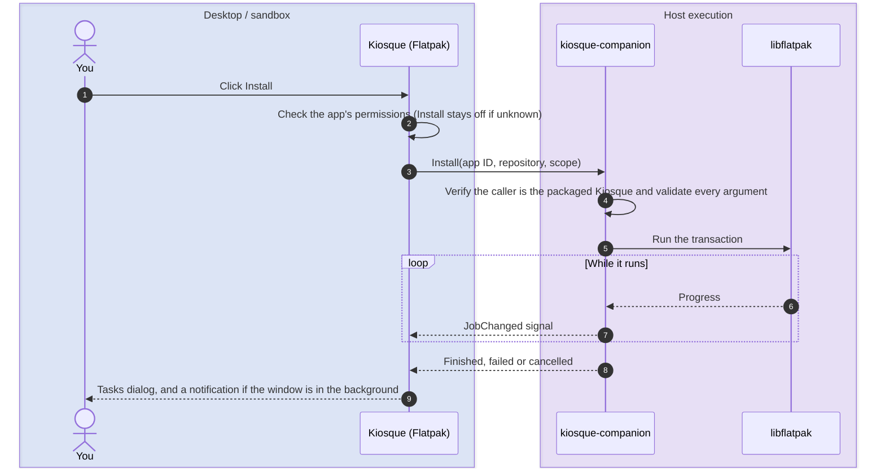

The blue band contains the user and sandboxed app; violet contains the authenticated host companion and native Flatpak execution.

#### When the storefront is closed

The `kiosque-update` executable from `kiosque-companion` serves two uses. D-Bus activation starts it on demand to handle requests, and it exits after an idle interval. While automatic updates are on it stays in background mode. It switches modes at runtime, so turning automatic updates on or off takes effect immediately rather than at the next login. It is a Qt-free Rust program: the core daemon owns scheduling and transactions, the tray is a `StatusNotifierItem` with a D-Bus menu served on the daemon’s own bus connection, and notifications go to `org.freedesktop.Notifications`. Its behaviour (daemon events and tray commands in, notifications and tray changes out) is a pure state machine, tested without a bus. The tray offers **Check for Updates** and **Update All**. The command-line `--check` mode checks **and installs** pending updates in one run. [Updater entry point and options](rust/updater/src/main.rs) · [Notifier state machine](rust/updater/src/shell.rs)

Every saved schedule is also sent to the running companion, which stores it. Enabling automatic updates also asks the desktop portal to start the companion at login. The settings controller waits for the response and restores the previous preference on rejection, so the switch reflects whether Kiosque could apply the change. Inside Flatpak, the login autostart runs `kiosque --update-companion`, which hands the schedule to the host companion and exits without opening a window. Enabling fails with an explanation when the companion is missing or too old.

The companion records when automatic updates were enabled and when the last run succeeded. Any scheduled time that passed since then is due, so a laptop that was off at 02:00 updates five minutes after the next login. Enabling counts from that moment, so it never triggers an immediate run. A failed run is retried after an hour. [Update schedule](rust/core/src/daemon/schedule.rs) · [Settings controller](rust/app/src/bridge/settings_controller.rs) · [Background integration](rust/core/src/settings.rs)

### Security boundaries

The hardening work changed both what the storefront accepts and what the sandbox can ask the host to do.

| Boundary | What Kiosque enforces |
| --- | --- |
| Sandboxed Flatpak operations | The typed host companion replaced host command spawning. It verifies the caller’s bus identity and requires a recognized native or packaged Kiosque executable. It validates app IDs, scopes, schedules and payloads, and publishes an API version so an outdated companion is reported as such. Flatpak and Polkit still enforce host authorization. |
| External repositories and app references | The confirmation screen displays the HTTPS origin, signing-key fingerprint, and target user installation. The operation consumes the descriptor bytes that were inspected and confirmed. |
| App permissions and remote content | Permissions come from the origin repository’s own metadata, which states what an installation grants. A known empty set and unavailable permissions are distinct states. Installation from the detail page requires known permissions. The API transport enforces public HTTPS destinations and response limits, and the image loader caps decoded size. |
| Sign-in and local settings | GitHub sign-in uses device authorization. GitLab sign-in uses PKCE. Bearer tokens stay in memory, and legacy settings records are migrated to remove stored tokens. Settings are written atomically with private permissions. |

For example, opening a repository file starts a review before any transaction can add the remote. Kiosque retains the descriptor and shows the origin and key fingerprint derived from those bytes. Confirmation passes the retained bytes to the backend, so changing the file on disk cannot substitute a different repository after review. The native transaction restricts the operation to the confirmed origin and denies additional dependency repositories. For an external app reference, missing runtimes come only from repositories you already have configured. [Sandbox and trust boundaries](docs/architecture.md#sandbox-and-trust-boundaries)

CI also includes dependency audits, redacted source and history secret scanning, CodeQL, and provenance for trusted package builds. Host Flatpak handles repository transport and repository trust. [Security hardening record](docs/security-hardening.md) · [Security policy](SECURITY.md)

### What happens when you search

1. Typing in the search field calls the QML-visible `AppListModel.search(query)`.
2. The Qt Bridge slot hands the query to the view layer, which starts a new request generation and waits 250 ms. Another keystroke in that time supersedes the request, so only the last query is ever sent.
3. On a Tokio worker, the app metadata policy ranks matches from the local AppStream catalog by name, keywords, ID and summary. This step never waits on the network. While Flathub’s own AppStream data is not on disk, results from `https://flathub.org/api/v2/search` are appended. A search fails only when neither source returned anything. Blocked apps are removed.
4. The result returns to the Qt thread through `QThreadHandle::invoke_mut`. A generation check drops stale replies, the model replaces its rows through a model reset and clears `loading`, and QML redraws the cards through the model roles. When the catalog is reindexed, for example after adding a repository, the model repeats its last search. [Search policy](rust/core/src/apps.rs) · [List queries](rust/app/src/view/app_list.rs) · [Search model](rust/app/src/bridge/app_list_model.rs)

## Development guidance and testing

Read [AGENTS.md](AGENTS.md) for repository workflows and [architecture](docs/architecture.md) for the Qt-free Rust core boundary. The shared [test runner](docs/testing.md) runs locally and in CI:

```sh
python3 scripts/test.py guidance
python3 scripts/test.py core
python3 scripts/test.py services
python3 scripts/test.py pr --backend native
```

The split between the core, the view layer and the adapters makes these checks useful at different points. The core suite can exercise transaction ordering and cancellation without loading Qt, and the view layer has its own `cargo test` coverage. Desktop tests run in `kiosque-quick-test`, a Rust binary that installs fixture endpoints, temporary settings and caches, and a mock Flatpak installation before running Qt Quick Test over `tests/qml`. QML tests drive the fixtures through the `TestSupport` and `BackendFixture` singletons, so a test exercises the same buttons, signals and model updates as the desktop app while controlling which requests succeed. [Test runner](rust/app/src/bin/quick_test.rs) · [Service construction for tests](rust/app/src/services.rs)

Real Flatpak lifecycle checks run only in disposable VMs. See the testing guide for desktop prerequisites, broker-only builds, artifact smoke tests and release qualification.

## License

This project is licensed under the terms of the **GNU General Public License version 3, or (at your option) any later version** (GPL-3.0-or-later).

For the complete license text, please refer to the [LICENSE](LICENSE) file in the root of this repository.
