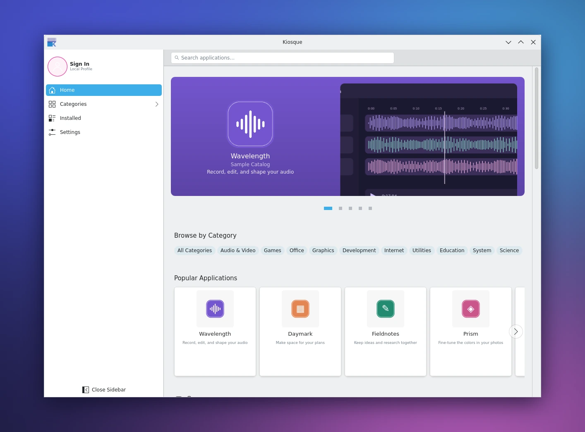
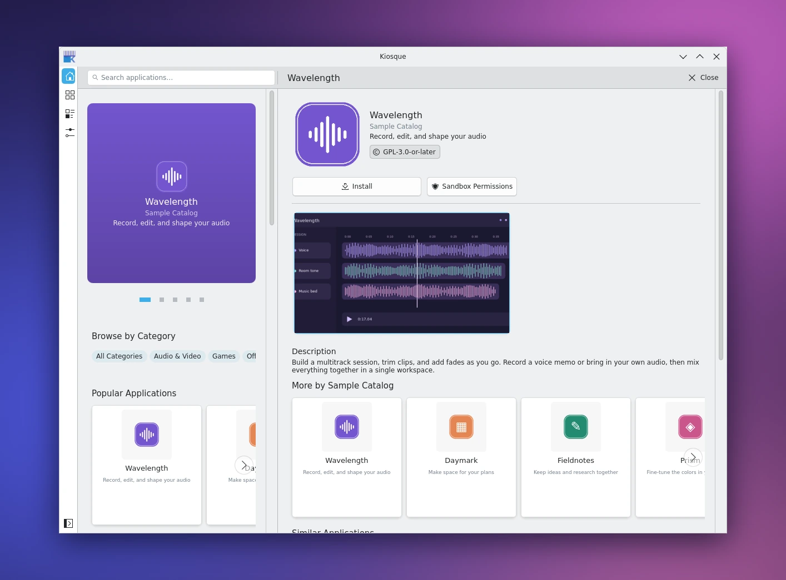
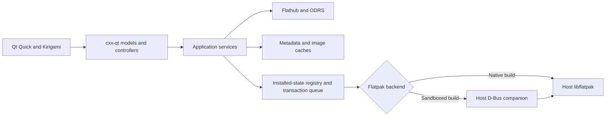

<div align="center">
  
  <h1>Kiosque</h1>
  <p><strong>A Flatpak storefront for KDE Plasma</strong></p>
  <p>Browse Flathub like an app store, see what each app can do, and manage your Flatpak library in a native Plasma interface.</p>
  <p>
    <a href="#try-kiosque">Try Kiosque</a> ·
    <a href="#technical-architecture--data-flow">Architecture</a> ·
    <a href="#build-from-source">Build from source</a> ·
    <a href="#development-guidance-and-testing">Development</a>
  </p>
</div>



*Screenshots show Kiosque with Plasma’s Breeze window decorations and a sample catalog.*

## Why Kiosque exists

Kiosque started when a GNOME user moved to KDE Plasma and missed the way Bazaar and GNOME Software made browsing for an app feel worthwhile. If all you have in mind is “I need something to edit audio,” a search box is only part of the answer. Kiosque gives you collections to explore, enough space to see what an app looks like, and a direct path from the first impression to the permissions it requests and the install action.

Discover covers the wider Plasma software workflow. Depending on the distribution and enabled backends, it can manage native packages and system updates alongside Flatpaks, and it can find Plasma add-ons. Kiosque concentrates its storefront and library on Flatpak. That focus gives the home page room for a dedicated daily spotlight, games by release and popularity, and a collection for apps suited to phones and tablets. Keep Discover for system software and Plasma add-ons, and open Kiosque when you want to explore Flathub or tend to your Flatpak library. [KDE Discover](https://invent.kde.org/plasma/discover)

### With thanks to Bazaar

**Kiosque owes its starting point to Bazaar and its contributors.** Bazaar showed how a Flatpak storefront could give editorial picks room to breathe, put application artwork to work, and make managing an installed library feel like part of the same experience. Kiosque carries that influence into its screenshot-led spotlight cards and its installed library, where update actions sit alongside the apps they affect. It also reads Bazaar-style YAML for distributor curation entries and blocklists. Credit for that design and configuration precedent goes to the Bazaar project. [Bazaar upstream](https://gitlab.gnome.org/World/bazaar)

## Try Kiosque

Check [GitHub Releases](https://github.com/niltonperimneto/kiosque/releases) for downloads. Choose a package for your system when one is available.

- **Fedora RPM** — Download the RPM, install it with `sudo dnf install ./<downloaded-file>.rpm` using the actual filename, then open **Kiosque** from your application launcher.
- **AppImage** — Make the downloaded `.AppImage` executable and open it.
- **Flatpak** — The sandboxed package uses a matching native host companion for Flatpak operations. Follow the release’s package instructions for installing the companion.

If there’s no suitable download, [build and run Kiosque from source](#build-from-source). For installing apps, see [Flathub’s setup guide](https://flathub.org/setup) to configure Flatpak and add the Flathub remote on your distribution.

Once it’s open, try **Games → New Releases**, then open a title and look at **Sandbox Permissions**. The **Installed** page shows the Flatpaks already on your machine and lets you focus on those with updates.

## From browsing to installing

- **Start with the storefront.** The featured carousel pairs app screenshots with colors from AppStream branding when available. Flathub’s App of the Day gets its own spotlight, and categories, game charts, and recently added or updated apps give you a way in even when you have no app name to search for.
- **Keep your place while deciding.** On a wide window the detail page opens beside the storefront. Screenshots, descriptions, ratings, and reviews help you judge the app itself, while the Sandbox Permissions panel lets you inspect the access it requests before installing. If permissions are unavailable, the detail page asks you to reload before installing.
- **Come back to a usable library.** Search and sort installed Flatpaks, filter to pending updates, and follow progress as operations run. For ongoing maintenance, Kiosque offers scheduled update checks through its background helper.



## Build from source

### Requirements & Setup

To build and run Kiosque from source, ensure you have the following dependencies:

- **Compiler**: GCC/Clang with C++17 support, and the current stable Rust toolchain (`cargo` and `rustc`, with Rust 2024 edition support)
- **Build System**: Meson (version 1.1+), Ninja, and a supported linker such as mold for cxx-qt initializer exports
- **System Libraries**:
  - Qt6 (Core, Gui, Qml, Quick, QuickControls2, DBus, Widgets, SVG)
  - KF6 Kirigami (KDE Frameworks 6 UI component system)
  - KF6 KI18n 6.21 or newer, including I18nQml and the `org.kde.ki18n` QML module
  - Qt SVG image plugin, Kirigami Addons, and KDE desktop QML style at runtime
  - `dbus-1` (D-Bus message bus system library)
  - libflatpak development libraries for the default native backend (`-Dflatpak_backend=broker` selects the sandbox build)

The [desktop test prerequisites](docs/testing.md#suite-matrix) list package names for Fedora.

### Building & Installation

Kiosque uses Meson to build the project. The build configuration automatically spawns Cargo to compile the Rust backend library (`libkiosque.a`) and links it directly into the C++ frontend binaries.

```bash
# Clone the repository
git clone https://github.com/niltonperimneto/kiosque.git
cd kiosque

# Configure the build directory
meson setup build

# Compile all targets (executable and update daemon)
meson compile -C build
```

Once built, you can launch Kiosque or the background update utility.

```bash
# Launch the graphical storefront
./build/kiosque

# Launch the background update utility
./build/kiosque-update
```

## Technical Architecture & Data Flow

Kiosque splits the desktop UI, application services, and Flatpak execution into layers. QML handles presentation and navigation, Rust owns catalog and transaction state, and libflatpak performs changes to the installation. The same application models serve the native and sandboxed packages through different backend implementations.



### Desktop views, Qt models, and the Rust bridge

- **Views.** `ShopfrontPage.qml` binds app collections to cards and search results. `AppDetailPage.qml` gets its own `AppDetails` object for metadata, permissions, and operation feedback. The installed library uses `InstalledModel`. Controllers expose shared operations and settings to QML.
- **Bindings.** The current build uses CXX-Qt 0.10. Rust modules under `rust/src/bridge/` declare QObject types with `#[cxx_qt::bridge]` and expose Qt properties, signals, and invokable methods. `cxx-qt-build` generates the C++ side and registers those types in the `com.kiosque` QML module. Meson links the `libkiosque` static library and its generated initializer into the desktop binary and embeds the QML resources. [Rust manifest](rust/Cargo.toml) · [Bridge registration](rust/build.rs)
- **Models and threads.** `AppListModel` implements `QAbstractListModel` in Rust, including `rowCount()`, `data()`, and `roleNames()`. QML delegates read the `name`, `summary`, `iconUrl`, and `appId` roles. Tokio does network and filesystem work in the background. The bridge queues accepted results onto Qt’s GUI thread through QObject thread handles, where the model emits updates.

### Application services, catalog, and caches

`kiosque-core` owns the catalog, service clients, caches, settings, installed-state registry, transaction queue, and Flatpak backend interface. The core builds with Rust alone under its default features. The native application enables the libflatpak feature. The desktop adapter wires up production services and supports isolated fixture endpoints and a mock backend in dedicated test builds. [Architecture guide](docs/architecture.md) · [Testing guide](docs/testing.md)

Flathub supplies collections, search, and AppStream metadata. The Open Desktop Ratings Service (ODRS) supplies ratings and reviews. The shared async HTTP client reuses connections, with up to four idle connections per host and a 15-second request timeout. Concurrent Moka caches keep collections for five minutes and app details, ratings, and reviews for ten. Featured content can appear from disk while a refresh runs. Review submissions invalidate that app’s cached ratings and reviews. The image loader coalesces duplicate downloads, keeps original bytes on disk, and limits decoded images in memory. [Flathub client](rust/core/src/flathub/client.rs) · [Cache policy](rust/core/src/cache.rs)

### Installed state, transactions, and the update helper

The storefront, detail pages, and library read a shared registry of installed apps, pending updates, and active jobs. The transaction queue serializes install, uninstall, and update operations, reports progress and cancellation, and reloads installed state before reporting completion. Native operations run libflatpak on blocking workers, use GLib’s cancellable for active work, and monitor installations for changes from other tools.

The packaged storefront chooses the backend at build time. The native package calls libflatpak directly. The sandboxed Kiosque Flatpak sends typed requests to the matching `kiosque-update` companion on the host over D-Bus. The companion handles on-demand requests and background update work. Scheduled background operation requires the desktop portal’s permission. [Backend and companion architecture](docs/architecture.md#sandbox-and-trust-boundaries)

### Security boundaries

The hardening work changed both what the storefront accepts and what the sandbox can ask the host to do.

| Boundary | What Kiosque enforces |
| --- | --- |
| Sandboxed Flatpak operations | The typed host companion replaced host command spawning. It verifies the caller’s bus identity and requires a recognized native or packaged Kiosque executable. It validates app IDs, scopes, and payloads. Flatpak and Polkit still enforce host authorization. |
| External repositories and app references | The confirmation screen displays the HTTPS origin, signing-key fingerprint, and target user installation. The operation consumes the descriptor bytes that were inspected and confirmed. |
| App permissions and remote content | A known empty permission summary and an unavailable summary are distinct states. Installation from the detail page requires a known summary. The API transport enforces public HTTPS destinations and response limits, and the image loader caps decoded size. |
| Sign-in and local settings | GitHub sign-in uses device authorization. GitLab sign-in uses PKCE. Bearer tokens stay in memory, and legacy settings records are migrated to remove stored tokens. Settings are written atomically with private permissions. |

CI also includes dependency audits, redacted source and history secret scanning, CodeQL, and provenance for trusted package builds. Host Flatpak handles repository transport and repository trust. [Security hardening record](docs/security-hardening.md) · [Security policy](SECURITY.md)

### What happens when you search

1. Submitting the search field in `ShopfrontPage.qml` invokes the QML-visible `AppListModel.search(query)`.
2. The Rust method receives a Qt `QString`, sets `loading`, and advances the model’s request generation. It captures a Qt thread handle and converts the query to a Rust string for the background task.
3. Tokio calls the shared Flathub client, which posts to `https://flathub.org/api/v2/search`. The client deserializes the response, and the adapter maps the results into app IDs, names, icons, and summaries.
4. The task queues the result back to the Qt thread. A generation check drops stale replies. For a changed result set, the model brackets the update with `beginResetModel()` and `endResetModel()`. It then clears `loading`, and QML redraws the cards through the model roles. [Search implementation](rust/src/bridge/app_list_model.rs)

## Development guidance and testing

Read [AGENTS.md](AGENTS.md) for repository workflows and [architecture](docs/architecture.md) for the Qt-free Rust core boundary. The shared [test runner](docs/testing.md) runs locally and in CI:

```sh
python3 scripts/test.py guidance
python3 scripts/test.py core
python3 scripts/test.py services
python3 scripts/test.py pr --backend native
```

Real Flatpak lifecycle checks run only in disposable VMs. See the testing guide for desktop prerequisites, broker-only builds, artifact smoke tests and release qualification.

## License

This project is licensed under the terms of the **GNU General Public License version 3, or (at your option) any later version** (GPL-3.0-or-later).

For the complete license text, please refer to the [LICENSE](LICENSE) file in the root of this repository.
