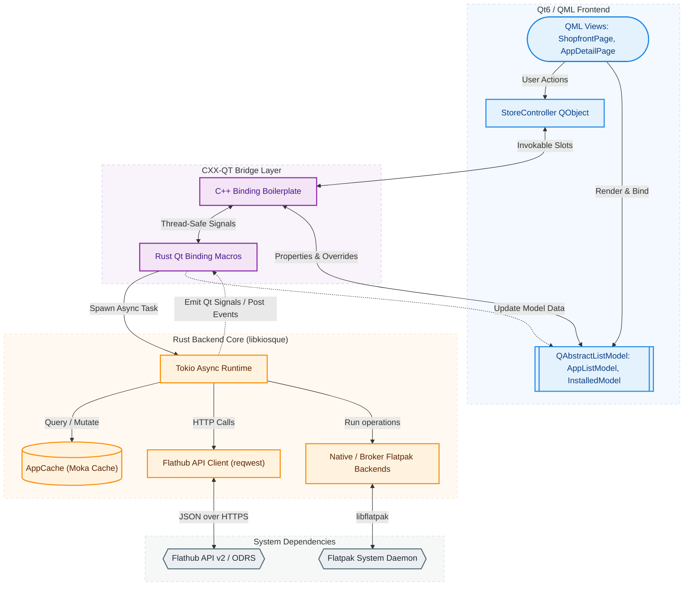

# Kiosque

<p align="center">
  
</p>

A beautiful, fast, and modern Flatpak storefront for the KDE Plasma desktop, inspired by GNOME's software curation aesthetics and built with a hybrid Rust + Qt6/Kirigami architecture.

## The Story & Purpose

The story behind Kiosque began when a GNOME user decided to try KDE Plasma. While the experience behind GNOME Software and *Bazaar* (a fast, Flatpak-centered storefront for GNOME) was highly polished and presented applications beautifully, KDE's default storefront, Discover, felt different. Although Discover is powerful, flexible, and robustly supports both Flatpaks and native packages, the overall storefront presentation can feel cluttered and utilitarian rather than visually engaging.

Kiosque was created to fill this gap: to build a Bazaar-equivalent storefront for the Qt/KDE ecosystem. It is designed to showcase applications in their best light, offering an eye-catching, clean, and intuitive way to discover and manage software for users who prefer a modern GUI over command-line tools.

---

## Detailed Feature Architecture

### 1. Modern Curation UI & Layout
- **Qt6 Quick & Kirigami Integration**: Built upon KDE Frameworks 6 Kirigami, utilizing standard design tokens, page layout models, and theme-adaptive components.
- **Translucent Storefront Styling**: Storefront components (such as *WelcomeCard* and *AppOfTheDayCard*) utilize custom translucency overlays and backdrop styling that align with KDE Human Interface Guidelines.
- **Smooth Animations**: Responsive card layout structures that dynamically transition during state changes, utilizing micro-animations to improve interactive feedback.

### 2. High-Performance Rust Backend (`libkiosque`)
- **Async Runtime**: Standardized on a multi-threaded `tokio` async runtime, offloading all expensive network calls, file system caching, and subprocess operations from the main GUI thread.
- **Type-Safe Serialization**: Utilizes `serde` and `serde_json` to parse high-payload JSON responses from Flathub APIs into structured Rust representations.
- **D-Bus Integration**: Leverages `zbus` for IPC, monitoring system tray notifications, background process states, and flatpak portal events natively under GNOME and KDE Plasma.

### 3. Flathub API Client & ODRS Integration
- **Connection Pooling**: Uses `reqwest::Client` in a process-wide `OnceLock` singleton. Reuses TCP connections and minimizes TLS handshake overhead with a connection pool size limits (e.g. 4 idle connections per host, 15s request timeout).
- **Open Desktop Ratings Service (ODRS)**: Asynchronously fetches star ratings and user reviews. Merges ODRS data with Flathub app metadata on the Rust side, delivering a unified model to the UI.

### 4. Smart Multi-Layer In-Memory Cache (`cache.rs`)
To minimize redundant network transactions and maintain a highly responsive UI, Kiosque uses a thread-safe, TTL-based caching layer managed by a process-wide `AppCache` singleton utilizing concurrent `moka` caches.
- **Collection Cache (TTL: 5 mins)**: Caches general feeds (popular, trending, recently added/updated).
- **Details Cache (TTL: 10 mins)**: Caches specific app metadata stream payloads to allow instant back-and-forth navigation.
- **ODRS Ratings/Reviews Cache (TTL: 10 mins)**: Caches user review lists and rating distributions.
- **Installed State Registry**: Shares installed refs, updates, and transaction state across views. Transactions reload installed state before publishing completion; installation monitors detect external changes.

### 5. Flatpak Backends and Transactions
- **Native backend by default**: Uses libflatpak for installation queries, transaction progress, cancellation, and installation monitoring.
- **Sandbox backend**: The packaged storefront requests typed operations from the native companion over D-Bus.
- **Shared state**: A registry and serialized transaction queue keep application views consistent and support explicit cancellation and worker shutdown.
- **Testable core**: Domain and service code lives in `kiosque-core`, which builds without Qt/KDE development libraries when its optional native feature is disabled.

### 6. Background Update Daemon (`kiosque-update`)
- **Independent Execution**: A dedicated helper binary that uses the Rust backend to check for updates and schedule downloads.
- **Portal & System Tray Integration**: Supports running as a background service via the `org.freedesktop.portal.Background` portal, offering system tray notifications and scheduled runs.

---

## Technical Architecture & Data Flow

Kiosque uses a hybrid architecture that bridges the performance and safety of Rust with the flexible UI capabilities of Qt6/QML.



### Detailed Architecture Layers

#### 1. Frontend Layer (QML & Kirigami)
The frontend is built using QML and styled with KDE's Kirigami framework. Views like `ShopfrontPage.qml` and `AppDetailPage.qml` are declared in QML. Instead of loading raw files, the QML UI binds to structured models (`AppListModel`, `InstalledModel`) and singular controllers (`StoreController`) defined in Rust and registered as native QML types.

#### 2. Qt bridge adapters

The `rust/app` crate registers `com.kiosque` QML models and controllers with `qtbridge` (pinned to 0.4.1). Async service results return through `QThreadHandle`; each QObject owns its subscription lifetime. The QML surface preserves the current storefront, settings, reviews, tasks, and update flows. `rust/updater` provides the standalone Rust companion shell.

Meson drives Cargo and installs the binaries, resources, translations and native companion integration. Qt's private development headers are required to build qtbridge; generated C++ glue remains inside Cargo's target directory.

## Detailed Data Flow Example: Searching for an Application

1. **User Action**: The user types a query into the Search field in `ShopfrontPage.qml`.
2. **QML Invocation**: QML invokes `search(query)` on the registered `AppListModel` instance.
3. **Bridge adapter**: the qtbridge `search(query: String)` slot advances the model's request generation and starts a debounced request using the injected Flathub client.
4. **GUI update**: a `QThreadHandle` posts the result to the Qt event loop. Superseded responses are rejected; current entries replace the list through qtbridge's reset API and finish the loading state. Destruction drops late callbacks and stops registry subscriptions.

---

## Requirements & Setup

To build and run Kiosque from source, ensure you have the following dependencies:

- **Compiler**: GCC/Clang with C++17 support, and the current stable Rust toolchain (`cargo` and `rustc`, with Rust 2024 edition support)
- **Build System**: Meson (version 1.4+), Ninja, and a supported linker such as mold
- **System Libraries**:
  - Qt6 (Core, Gui, Qml, Quick, QuickControls2, DBus, Widgets)
  - KF6 Kirigami (KDE Frameworks 6 UI component system)
  - KF6 I18n & I18nQml (KDE Frameworks 6 translation support)
  - `dbus-1` (D-Bus message bus system library)
  - libflatpak development libraries for the default native backend (`-Dflatpak_backend=broker` selects the sandbox build)

---

## Building & Installation

Kiosque uses Meson to build the project. The build configuration automatically spawns Cargo to compile the Rust backend library (`libkiosque.a`) and links it directly into the C++ frontend binaries.

```bash
# Clone the repository
git clone https://github.com/niltonperimneto/Kiosque.git
cd Kiosque

# Configure the build directory
meson setup build

# Compile all targets (executable and update daemon)
meson compile -C build
```

Once built, you can launch Kiosque or the background update utility:
```bash
# Launch the graphical storefront
./build/kiosque

# Launch the background update utility
./build/kiosque-update
```

---

## License

This project is licensed under the terms of the **GNU General Public License version 3, or (at your option) any later version** (GPL-3.0-or-later).

For the complete license text, please refer to the [LICENSE](file:///home/niltonperimneto/Kiosque/LICENSE) file in the root of this repository.

## Development guidance and testing

Read [AGENTS.md](AGENTS.md) for repository workflows and [architecture](docs/architecture.md) for the Qt-free Rust core boundary. The shared [test runner](docs/testing.md) runs locally and in CI:

```sh
python3 scripts/test.py guidance
python3 scripts/test.py core
python3 scripts/test.py services
python3 scripts/test.py pr --backend native
```

Real Flatpak lifecycle checks run only in disposable VMs. See the testing guide for desktop prerequisites, broker-only builds, artifact smoke tests and release qualification.
