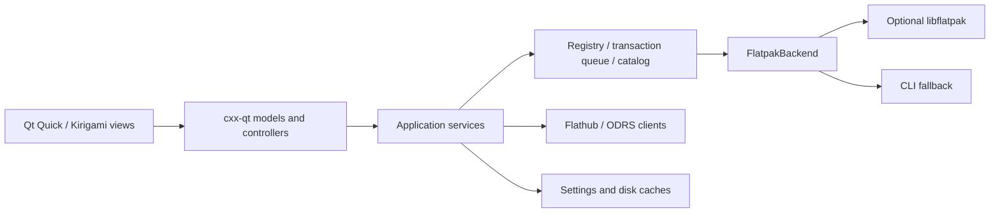

# Kiosque architecture

Kiosque uses a Cargo workspace under `rust/`. `kiosque-core` owns the Qt-independent domain and services. `libkiosque` remains the static library linked by Meson and exports the existing `com.kiosque` QML types.

## Ownership and composition

- Core default features contain no Qt, KDE or libflatpak dependency. The application's default `libflatpak` feature forwards to the optional core backend. Disabling it retains CLI operation. The Flatpak manifest explicitly selects CLI mode to route operations through the host command instead of requiring libflatpak inside the KDE runtime. It grants `org.freedesktop.Flatpak` D-Bus access, which the host-spawn interface requires.
- The application composition root is `rust/src/services.rs`. Production constructors use production endpoints and paths. Dedicated `test-util` builds can install isolated services before any QObject is created; release builds do not export that bootstrap.
- Registry owns installed/update/job state. TransactionManager serializes backend operations, deduplicates complete operations including scope and remote, and publishes terminal state after reloading installed refs. `shutdown()` cancels pending operations and joins the worker. Worker ownership uses a weak reference to avoid an idle Arc cycle.
- Qt models project registry snapshots into serializable core entries. The adapter's compatibility helpers retain existing UI method names while sending mutations through the shared transaction client. Model/controller event subscriptions stop when their Rust QObject state is destroyed.
- Each HTTP client owns its transport, API base and cache handle. Production constructors share the production cache; explicit constructors allow independent caches/endpoints. Settings persistence and disk caches accept explicit paths; saving settings does not invoke a portal or systemctl. Background/autostart integration remains an explicit operation.
- The settings controller invokes background integration when the user changes automatic updates. It awaits the portal's permission response, reports failures to QML and restores the saved automatic-update preference on rejection. Schedule-only edits do not repeat the permission request. Settings controls save on user interaction rather than initialization, and persist canonical schedule identifiers.
- Successful review submission invalidates that app's review/rating cache. Review-ID-only voting and moderation invalidate review/rating caches across apps, retaining catalog and detail caches. The detail page displays load/action errors and reloads review data after successful mutations.
- The core image loader owns its transport, disk directory, download locks and decoded-frame cache (96 MiB, ten-minute TTL). Cache identities include the source URL and requested dimensions, plus file metadata for local images. Downloads retain original bytes; SIMD resizing runs on blocking workers.
- Image decoding returns owned pixels from core. Only the adapter exposes raw C buffers, and the shared C++ image provider transfers each allocation to a QImage cleanup callback that frees it exactly once. Provider URLs encode the underlying URL, so changing metadata cannot reuse an old app-ID image mapping.

## Execution and compatibility

Tokio performs network, filesystem and process work. Qt changes are posted through cxx-qt thread handles. App-list request generations reject responses for superseded requests. The native backend runs libflatpak work on blocking workers; CLI children are owned and reaped during cancellation.

Meson builds the explicit `libkiosque` package, links its static library and exported cxx-qt initializer object, and embeds QML resources. Keep the initializer export integration aligned with cxx-qt upgrades; its export layout is not a stable public interface.

The new core cache format is versioned. Old incompatible cache files are ignored. No settings schema migration is required; older records without an ODRS salt receive a generated salt when loaded.

The updater's existing C++ tray/one-shot shell is retained. The core daemon modules expose the ongoing Rust daemon refactor; a broader rewrite of the C++ shell is not part of the test architecture migration.

## Sandbox and trust boundaries

The Flatpak build uses the CLI backend and runs `flatpak-spawn --host flatpak …`, which needs `--talk-name=org.freedesktop.Flatpak`. That name lets the app run host commands, so every value that becomes a `flatpak` argument (app ids, refs, remote names, repository URLs) is validated in `flatpak/cli.rs` before spawning. Option-like values (leading `-`) and characters outside flatpak's own id and name syntax are rejected. Keep this check in front of any new CLI call.

Every other permission is read-only and scoped to what the code reads:

| Permission | Reason |
| --- | --- |
| `/var/lib/flatpak:ro`, `xdg-data/flatpak:ro` | AppStream catalog and installed-state monitoring (`flatpak::installation_paths`) |
| `host-etc:ro`, `host-os:ro` | Distributor configuration under `/run/host/etc/kiosque` and `/run/host/usr/share/kiosque` |
| `org.freedesktop.Notifications`, `org.kde.StatusNotifierWatcher` | Update notifier notifications and tray icon |

The app writes only to its own `~/.var/app` directories. Temporary `.flatpakref`/`.flatpakrepo` files go to its cache directory, which has the same path on the host. Do not reintroduce `--filesystem=host`. Never include OAuth response bodies in errors or logs, since they can contain tokens.

## Storefront projections

Mobile and sorted Games collections use the injected Flathub client. App-list and featured request generations reject stale completions. The featured model separates App of the Day by app ID and exposes branding colors and screenshots; unchanged projections avoid model resets. Featured disk entries use schema 2, while other cache schemas remain unchanged. The roadmap's per-page AppDetails and daemon-backed updater remain the integration baseline.
