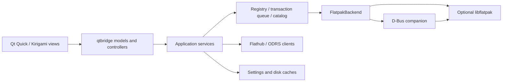

# Kiosque architecture

Kiosque uses a Cargo workspace under `rust/`. `kiosque-core` owns the Qt-independent domain and services. `rust/app` registers the existing `com.kiosque` QML types through qtbridge 0.4.1. Meson invokes Cargo to build the Rust application, updater, and dedicated desktop harness.

## Ownership and composition

- Core default features contain no Qt, KDE or libflatpak dependency. The application's default `libflatpak` feature forwards to the optional core backend. A build without the feature requires the sandbox broker. The Flatpak build does not link libflatpak. Sandboxed processes select a constrained D-Bus broker backend and require the native `kiosque-update` companion on the host; they never fall back to host spawning. The manifest grants only the companion bus name and disables installation of sandbox daemon activation/KRunner files.
- The application composition root is `rust/app/src/services.rs`. Production constructors use production endpoints and paths. Dedicated `test-util` builds can install isolated services before any QObject is created; release builds do not export that bootstrap.
- Registry owns installed/update/job state. TransactionManager serializes backend operations, deduplicates complete operations including scope and remote, and publishes terminal state after reloading installed refs. `shutdown()` cancels pending operations and joins the worker. Worker ownership uses a weak reference to avoid an idle Arc cycle.
- Qt models project registry snapshots into serializable core entries. The adapter's compatibility helpers retain existing UI method names while sending mutations through the shared transaction client. Model/controller event subscriptions stop when their Rust QObject state is destroyed.
- Each HTTP client owns its transport, API base and cache handle. Production constructors share the production cache; explicit constructors allow independent caches/endpoints. Settings persistence and disk caches accept explicit paths; saving settings does not invoke a portal or systemctl. Background/autostart integration remains an explicit operation.
- The settings controller invokes background integration when the user changes automatic updates. It awaits the portal's permission response, reports failures to QML and restores the saved automatic-update preference on rejection. Schedule-only edits do not repeat the permission request. Settings controls save on user interaction rather than initialization, and persist canonical schedule identifiers.
- The window navigates one page at a time (single-column page stack): a sidebar on wide windows, a bottom tab bar on narrow ones, both driven by `Main.qml`'s shared `navigationActions`. Categories come from one translated list (`qml/components/Categories.qml`). The Updates page shares the window's `InstalledModel` so an update in progress survives navigation; each page sets the model filters it needs and clears them on destruction.
- `JobsModel` mirrors `Registry::jobs()` for the Tasks dialog and reports each job that finishes from the order of job events, so installs never block the window. Desktop notifications go through `kiosque_core::notifications` (`org.freedesktop.Notifications`) only when the window is inactive.
- Repositories are only added after inspection: a manually entered address goes through the same `.flatpakrepo` confirmation (origin and signing-key fingerprint) as an opened file.
- Successful review submission invalidates that app's review/rating cache. Review-ID-only voting and moderation invalidate review/rating caches across apps, retaining catalog and detail caches. The detail page displays load/action errors and reloads review data after successful mutations.
- The core image loader owns its transport, disk directory, download locks and decoded-frame cache (96 MiB, ten-minute TTL). Cache identities include the source URL and requested dimensions, plus file metadata for local images. Downloads retain original bytes; SIMD resizing runs on blocking workers.
- `RemoteImage` produces bounded, sanitized PNG files through `core::sanitized_image`, using the same hardened HTTP transport as the storefront. `RemoteImageView.qml` retains Image sizing and fill behavior; Qt only decodes the resulting local PNG. The Qt-free pixel loader remains available for core consumers and its cache contracts.
- Signals keep the current public QML names. Completion handlers that mutate the emitting Rust object defer with `Qt.callLater`, since qtbridge borrows the object during signal emission. Registry subscriptions own cancellation tokens and late queued callbacks are discarded when the QObject is gone.

## Execution and compatibility

Tokio performs network, filesystem and process work. Qt changes are posted through qtbridge thread handles. App-list request generations reject responses for superseded requests. The native backend runs libflatpak work on blocking workers; GCancellable delivers cancellation to active native transactions.

Meson delegates binary builds and QML resource embedding to Cargo. The qtbridge runtime generates its C++ glue; no hand-written C++ adapter is retained. Its build requires the matching Qt private development headers in addition to the public Qt Quick dependencies.

The new core cache format is versioned. Old incompatible cache files are ignored. Loading settings removes legacy OAuth tokens and persists missing ODRS salts. Settings directories/files use modes 0700/0600; atomic writes reject symlinks. OAuth bearer tokens are used only in memory to fetch a profile. GitLab sign-in uses PKCE and ephemeral loopback listeners; GitHub uses device authorization and requires device flow to be enabled in its OAuth application.

The updater is a Qt-free Rust tray/notification shell over the same hardened daemon services. The daemon publishes typed Rust events to that shell and retains the current sender authorization, native backend, broker, scheduling, and cancellation behavior.

## Sandbox and trust boundaries

The Flatpak build talks only to `org.kiosque.Kiosque.Daemon`. Install the native host package to provide the companion. An absent or unauthorized companion produces an explicit operation failure; the sandbox cannot start its own host daemon. Native packages use libflatpak directly.

The companion obtains sender UID/PID from D-Bus and checks the executing native sibling or packaged Flatpak application identity before reading or mutating state. For a filtered bus connection it verifies the system proxy executable, the app and instance IDs from its private Flatpak metadata, and the packaged executable of the live instance reported by libflatpak. Its methods accept typed identifiers, scopes and bounded descriptor bytes, never commands, paths or environments. Queue submissions validate identifiers and cap active operations at 32, ref files at 1 MiB and update batches at 256 IDs. This policy trusts the current Unix account and does not replace host Flatpak/Polkit system authorization.

External descriptors require a single, unambiguous HTTPS origin and signing key. The UI reviews retained descriptor bytes, origin, key SHA-256 and user installation scope before committing. Native transactions allow only the confirmed primary origin; dependency repositories are denied. External-reference transactions do not fetch missing dependencies/related refs automatically. Production HTTP clients reject local/private destinations, proxies, redirects and oversized decoded responses. Flatpak's own repository transport and trust checks remain the responsibility of the host Flatpak implementation.

Every other permission is read-only and scoped to what the code reads:

| Permission | Reason |
| --- | --- |
| `/var/lib/flatpak:ro`, `xdg-data/flatpak:ro` | AppStream catalog and installed-state monitoring (`flatpak::installation_paths`) |
| `host-etc:ro`, `host-os:ro` | Distributor configuration under `/run/host/etc/kiosque` and `/run/host/usr/share/kiosque` |
| `org.freedesktop.Notifications`, `org.kde.StatusNotifierWatcher` | Update notifier notifications and tray icon |

The app writes only to its own `~/.var/app` directories. Descriptor bytes cross the companion API; sandbox paths never cross it. Do not reintroduce `--filesystem=host`. Never include OAuth response bodies in errors or logs, since they can contain tokens.

## Storefront projections

Mobile and sorted Games collections use the injected Flathub client. App-list and featured request generations reject stale completions. The featured model separates App of the Day by app ID and exposes branding colors and screenshots; unchanged projections avoid model resets. Featured disk entries use schema 3, while other cache schemas remain unchanged. The roadmap's per-page AppDetails and daemon-backed updater remain the integration baseline.
